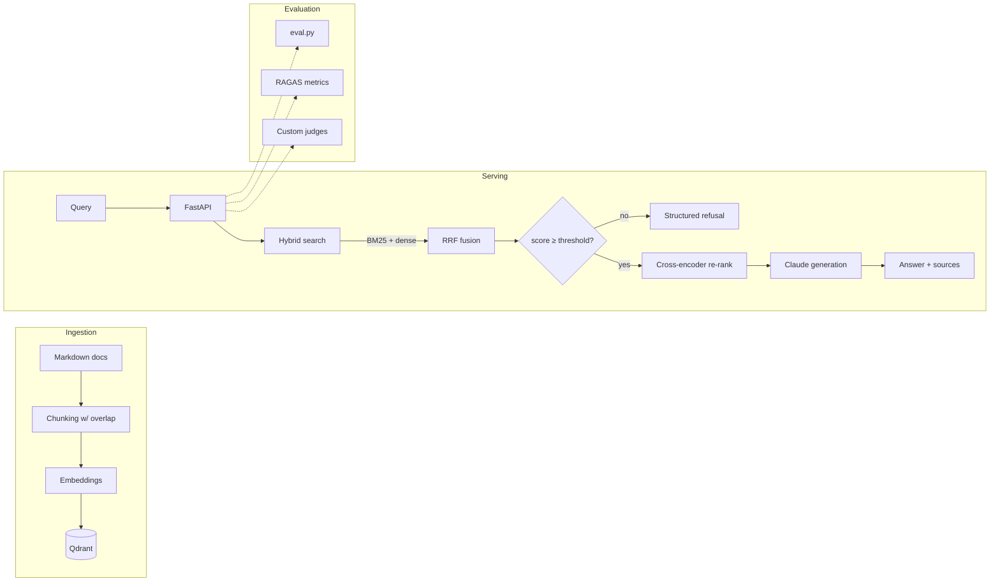

# Miles RAG PoC

[](https://github.com/WaiteM124/miles-rag/actions/workflows/ci.yml)

A proof-of-concept retrieval-augmented generation (RAG) assistant demonstrating hybrid search, grounded generation, and evaluation-driven development. Built as a learning project and portfolio piece.

## What This Actually Is

~750 lines of Python implementing a complete, production-aware RAG pipeline:

- **Hybrid retrieval + cross-encoder re-ranking**: BM25 + dense vectors fused with weighted RRF, then re-scored by a fine-tuned cross-encoder
- **Grounded generation**: Strict citation and explicit refusal protocol using Claude
- **Structured failure modes**: Threshold-gated refusal instead of hallucination on out-of-scope queries
- **Streaming responses**: Token-by-token answer streaming via the Anthropic streaming API
- **Observable pipeline**: Structured per-stage latency and score logs for every retrieval event
- **Evaluation harness**: Offline `eval.py` (recall@K, faithfulness) + RAGAS baseline + custom LLM judges
- **Sample corpus**: 3 synthetic ERP/FP&A documents (~3 chunks)
- **Golden dataset**: 35 hand-written Q&A pairs for evaluation



## Quick Start

### One-Command Demo
```bash
# Requires: ANTHROPIC_API_KEY environment variable
export ANTHROPIC_API_KEY='your-key-here'

# Run the demo (uses in-memory Qdrant, no Docker required)
# Shows streaming output and observable retrieval logs
make demo
```

The demo streams answers token-by-token and writes structured retrieval logs (chunk IDs, RRF scores, re-ranker scores, per-stage latency) to stderr.

### Full Setup

```bash
# Start Qdrant (optional - demo uses in-memory mode)
docker compose up -d

# Install dependencies
pip install -r requirements.txt

# Configure
cp .env.example .env
# Edit .env with your ANTHROPIC_API_KEY

# Ingest sample documents
python ingestion.py

# Run the API
uvicorn main:app --reload

# Query (standard)
curl -X POST http://localhost:8000/query \
  -H "Content-Type: application/json" \
  -d '{"question": "How do I post a manual journal?"}'

# Query (streaming)
curl -X POST http://localhost:8000/query/stream \
  -H "Content-Type: application/json" \
  -d '{"question": "How do I post a manual journal?"}' \
  --no-buffer
```

---

## Feature Deep-Dives

### 1. Hybrid Retrieval + Cross-Encoder Re-Ranking

The retrieval pipeline runs five stages in sequence:

| Stage | Implementation | Purpose |
|---|---|---|
| BM25 sparse | `rank_bm25.BM25Okapi` | Exact keyword matching |
| Dense vector | `sentence-transformers/all-MiniLM-L6-v2` + Qdrant HNSW | Semantic similarity |
| Weighted RRF | Custom `weighted_rrf()` with `BM25_WEIGHT=0.4`, `DENSE_WEIGHT=0.6` | Fuse ranked lists |
| Threshold filter | `MIN_SCORE_THRESHOLD=0.004` (env-configurable) | Discard low-confidence candidates |
| Cross-encoder re-rank | `cross-encoder/ms-marco-MiniLM-L-6-v2` | Precision re-scoring of survivors |

The cross-encoder is **lazy-loaded** on first use to keep cold-start time low. The BM25 index is rebuilt on demand; call `retriever.refresh_bm25_index()` after ingesting new documents.

**Why this matters**: Hybrid retrieval + re-ranking consistently outperforms either approach alone on recall and precision. The cross-encoder is a fine-tuned BERT model that sees the full (query, passage) pair and assigns a relevance logit — more accurate than cosine similarity at the cost of higher latency (run only on the small post-RRF candidate set).

### 2. Evaluation Harness (`eval.py`)

A standalone offline evaluation script requiring **no API key** by default:

```bash
# Offline mode — measures retrieval recall, no LLM calls
python eval.py

# Full mode — also generates answers and measures faithfulness
python eval.py --answer

# Custom top-k
python eval.py --top-k 5
```

Metrics:

| Metric | Definition |
|---|---|
| **Recall@K** | Fraction of answerable questions where ≥1 of the top-K chunks contains relevant content (keyword overlap against reference answer) |
| **MRR** | Mean Reciprocal Rank of the first relevant chunk |
| **Answer Faithfulness** | Fraction of reference-answer keywords present in the generated answer (keyword overlap proxy; no LLM judge needed) |

The script includes 10 hardcoded QA pairs (8 answerable, 2 out-of-scope) exercising the ERP/FP&A corpus. For the full 35-question RAGAS evaluation see `run_ragas.py`.

### 3. Failure Modes

**Similarity threshold gating**: After RRF fusion, every candidate chunk is compared against `MIN_SCORE_THRESHOLD` (default `0.004`, env-configurable). When *no* chunk clears the threshold (e.g. for a Salesforce integration question against an ERP journal corpus), `retrieval.py` returns an empty list and `generation.py` emits a structured refusal immediately — the LLM is never called, preventing hallucination on out-of-scope queries.

```python
# generation.py
NO_CONTEXT_RESPONSE = (
    "REFUSAL: NO RELEVANT CONTEXT FOUND — the query did not match any document "
    "chunks above the minimum similarity threshold. ..."
)

def answer(query, chunks):
    if not chunks:
        return NO_CONTEXT_RESPONSE  # LLM never called
    ...
```

**Chunk boundary overlap**: `ingestion.py` uses `CHUNK_SIZE=500` words with `CHUNK_OVERLAP=80` words. The 16% overlap ensures that facts spanning a chunk boundary are present in at least one complete chunk, preventing truncation artifacts.

### 4. Streaming Responses

The LLM answer streams token-by-token via Anthropic's `messages.stream()` context manager, exposed through two interfaces:

**FastAPI endpoint** (`POST /query/stream`):
```bash
curl -X POST http://localhost:8000/query/stream \
  -H "Content-Type: application/json" \
  -d '{"question": "How do I post a manual journal?"}' \
  --no-buffer
```
Returns `text/plain` chunked transfer encoding. Does not use the LRU cache — always produces a fresh response.

**Python generator** (`generation.answer_stream`):
```python
from generation import answer_stream

for token in answer_stream(question, chunks):
    sys.stdout.write(token)
    sys.stdout.flush()
```

Both interfaces handle the empty-chunks case gracefully: when no context was found, the full refusal string is yielded as a single chunk without touching the network.

### 5. Observable Pipeline

Every retrieval event emits a single structured log line to `stderr` via Python's standard `logging` module. Enable with:

```python
import logging, sys
logging.basicConfig(level=logging.INFO, stream=sys.stderr,
                    format="%(asctime)s [%(name)s] %(message)s")
```

Example output for a single query:
```
09:15:32 [retrieval] retrieval stage=bm25 query='How do I post a manual journal?' candidates=16 latency_ms=0.4
09:15:32 [retrieval] retrieval stage=dense query='How do I post a manual journal?' candidates=16 latency_ms=48.2
09:15:32 [retrieval] retrieval stage=rrf_fusion query='How do I post a manual journal?' candidates=8 bm25_ms=0.4 dense_ms=48.2 rrf_ms=0.1
09:15:32 [retrieval] retrieval stage=threshold_filter query='How do I post a manual journal?' threshold=0.0040 passed=8/8
09:15:32 [retrieval] retrieval stage=final rank=1 chunk_id=3f8a1b2c source=data/docs/erp/journals.md rrf_score=0.0164 reranker_score=8.73 total_ms=312.5
09:15:32 [retrieval] retrieval stage=final rank=2 chunk_id=7c2d9e4f source=data/docs/erp/journals.md rrf_score=0.0126 reranker_score=4.21 total_ms=312.5
```

Fields logged per event: `stage`, `query` (truncated to 80 chars), `chunk_id`, `source`, `rrf_score`, `reranker_score`, per-stage and total `latency_ms`. The demo enables these logs by default.

---

## Results

Evaluation on the 35-question golden dataset (`golden_sample.jsonl`).

### Retrieval Metrics (Offline)

Computed with `python eval_retrieval.py` using in-memory Qdrant:

| Metric | Value |
|--------|-------|
| Hit Rate @ 8 | 100% |
| MRR | 1.000 |
| Answerable Questions | 26 |
| Out-of-scope / Ambiguous | 9 |

**Reproduce:**
```bash
python eval_retrieval.py --output results/retrieval_metrics.json
```

The perfect retrieval scores reflect the small corpus size (3 documents, 3 chunks) and carefully crafted golden questions. With a larger corpus, expect these numbers to drop.

### LLM-Judged Metrics (Requires API Key)

<!-- LLM_METRICS_START -->
*Not yet run. To generate:*

```bash
# Start the API server
docker compose up -d
python ingestion.py
uvicorn main:app &

# Run RAGAS + custom judges (requires ANTHROPIC_API_KEY)
export ADMIN_TOKEN='your-admin-token'
python run_ragas.py golden_sample.jsonl results/llm_metrics.json
```

Expected metrics (when run):
- RAGAS: faithfulness, answer_relevancy, context_precision, context_recall
- Custom judges: extractability, refusal_clarity by question category
<!-- LLM_METRICS_END -->

## Running Tests

```bash
# Run tests (offline, no external services needed)
make test

# Or directly:
pytest tests/ -v

# Lint
make lint
```

## Project Structure

```
config.py             Environment config, retrieval weights, threshold, model names
retrieval.py          Hybrid search: BM25 + dense, RRF, threshold, cross-encoder re-rank
generation.py         Grounded prompts, refusal protocol, streaming (answer_stream)
ingestion.py          Chunk (with overlap) and embed documents to Qdrant
main.py               FastAPI endpoints: /query (cached), /query/stream (streaming)
demo.py               One-command demo with streaming output + observable logs
eval.py               Offline eval harness: recall@K + faithfulness, no API key needed
eval_retrieval.py     Offline retrieval evaluation (hit rate, MRR)
run_ragas.py          Full evaluation harness (requires API + LLM)
custom_judges.py      Extractability and refusal clarity judges
golden_sample.jsonl   35 evaluation questions
results/              Evaluation output files
tests/                Unit tests (mocked, run offline)
data/docs/            Sample ERP/FP&A documentation
Makefile              Common commands (demo, test, lint)
```

## Key Design Decisions

**Hybrid retrieval + re-ranking**: BM25 handles exact terminology (account codes, field names) while dense embeddings handle paraphrased queries. RRF fusion is robust to score-scale differences between the two systems. The cross-encoder re-ranker then applies a more expensive but more accurate pairwise relevance model to the small post-fusion candidate set.

**Threshold-gated refusals**: Rather than passing empty or irrelevant context to the LLM (which causes hallucination), the pipeline gates on a configurable RRF score threshold. Below-threshold queries return a structured `REFUSAL:` response that is programmatically detectable and costs zero LLM tokens.

**Streaming first**: The `/query/stream` endpoint streams tokens as they arrive, reducing perceived latency for end users. The generator interface (`answer_stream`) lets callers write UI streaming logic without coupling to HTTP.

**Structured observability**: One log line per pipeline stage with explicit field names (stage, latency_ms, scores, IDs) makes it straightforward to pipe output into any log aggregator (Datadog, CloudWatch, etc.) without additional instrumentation.

**Explicit refusals**: The system prompt requires the model to respond with `REFUSAL:` prefix when information isn't in the retrieved context. This makes refusals programmatically detectable by `is_refusal()`.

**Incremental ingestion**: Documents are assigned stable IDs based on content hash, so re-running ingestion upserts rather than duplicates.

**Bounded cache**: Query responses are cached with TTL and LRU eviction. The cache-clear endpoint requires an `ADMIN_TOKEN` for security.

**Custom evaluation**: Beyond standard RAGAS metrics, custom judges evaluate whether answers are machine-extractable (for downstream automation) and whether refusals are clearly detectable.

## Limitations

This is a proof-of-concept with intentional simplifications:

- Single-tenant (no collection isolation)
- In-memory BM25 index (not persisted)
- No deployment configuration
- Sample corpus is tiny (3 chunks)

## Production Version Would Add

- **Multi-tenancy**: Per-tenant Qdrant collections
- **Persistence**: Redis for caching, persistent BM25 index
- **Document sync**: S3/GCS ingestion with change detection
- **Deployment**: Kubernetes manifests, health checks, autoscaling
- **CI/CD**: Evaluation gates on deployment
- **Observability integration**: Ship retrieval logs to Langfuse / Datadog

## License

MIT
