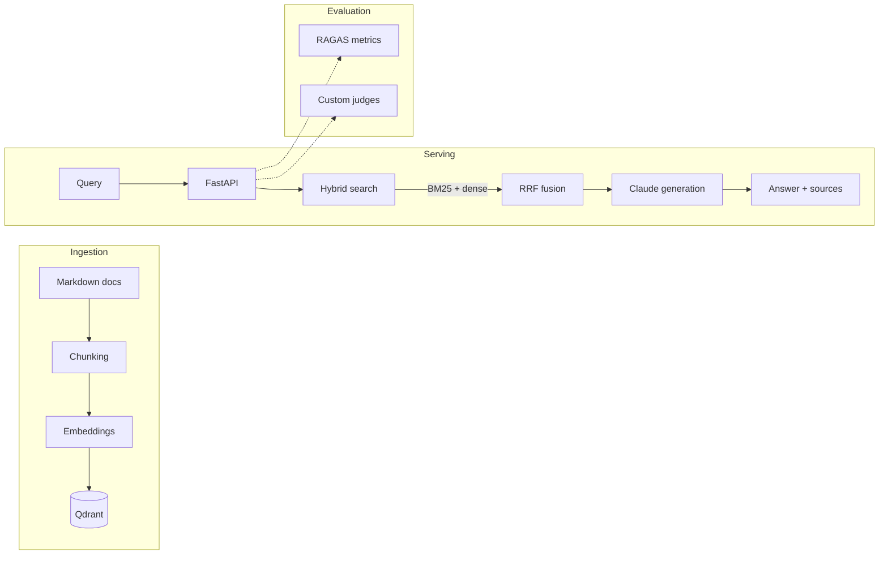

# Miles RAG PoC

[](https://github.com/WaiteM124/miles-rag/actions/workflows/ci.yml)

A proof-of-concept retrieval-augmented generation (RAG) assistant demonstrating hybrid search, grounded generation, and evaluation-driven development. Built as a learning project and portfolio piece.

## What This Actually Is

~550 lines of Python implementing a minimal but complete RAG pipeline:

- **Hybrid retrieval**: BM25 + dense vectors fused with weighted reciprocal rank fusion
- **Grounded generation**: Strict citation and explicit refusal protocol using Claude
- **Evaluation harness**: RAGAS baseline metrics plus custom LLM-as-judge evaluators
- **Sample corpus**: 3 synthetic ERP/FP&A documents (~40 chunks)
- **Golden dataset**: 35 hand-written Q&A pairs for evaluation



## Quick Start

```bash
# Start Qdrant
docker compose up -d

# Install dependencies
pip install -r requirements.txt

# Configure
cp .env.example .env
# Edit .env with your ANTHROPIC_API_KEY

# Ingest sample documents
python ingestion.py

# Run the API
uvicorn main:app --reload

# Query
curl -X POST http://localhost:8000/query \
  -H "Content-Type: application/json" \
  -d '{"question": "How do I post a manual journal?"}'
```

## Running Tests

```bash
# Install dev dependencies
pip install -r requirements.txt

# Run tests (offline, no external services needed)
pytest tests/ -v

# Lint
ruff check .
ruff format --check .
```

## Project Structure

```
config.py           Environment config and retrieval weights
retrieval.py        Hybrid search: BM25 + dense vectors, RRF fusion
generation.py       Grounded prompts, refusal protocol
ingestion.py        Chunk and embed documents to Qdrant
main.py             FastAPI endpoints with LRU cache
run_ragas.py        Evaluation harness (requires running API + LLM)
custom_judges.py    Extractability and refusal clarity judges
golden_sample.jsonl 35 evaluation questions
tests/              Unit tests (mocked, run offline)
data/docs/          Sample ERP/FP&A documentation
```

## Key Design Decisions

**Hybrid retrieval**: Combines BM25 (keyword matching) with dense embeddings via weighted reciprocal rank fusion. The BM25 index is rebuilt on demand; call `retriever.refresh_bm25_index()` after ingestion.

**Explicit refusals**: The system prompt requires the model to respond with `REFUSAL:` prefix when information isn't in the retrieved context. This makes refusals programmatically detectable.

**Incremental ingestion**: Documents are assigned stable IDs based on content hash, so re-running ingestion upserts rather than duplicates.

**Bounded cache**: Query responses are cached with TTL and LRU eviction. The cache-clear endpoint requires an `ADMIN_TOKEN` for security.

**Custom evaluation**: Beyond standard RAGAS metrics, custom judges evaluate whether answers are machine-extractable (for downstream automation) and whether refusals are clearly detectable.

## Limitations

This is a proof-of-concept with intentional simplifications:

- Single-tenant (no collection isolation)
- In-memory BM25 index (not persisted)
- No observability/tracing integration
- No deployment configuration
- Sample corpus is tiny (~40 chunks)

## Production Version Would Add

- **Multi-tenancy**: Per-tenant Qdrant collections
- **Observability**: Langfuse or similar for query/retrieval/generation tracing
- **Persistence**: Redis for caching, persistent BM25 index
- **Document sync**: S3/GCS ingestion with change detection
- **Deployment**: Kubernetes manifests, health checks, autoscaling
- **CI/CD**: Evaluation gates on deployment

## License

MIT
