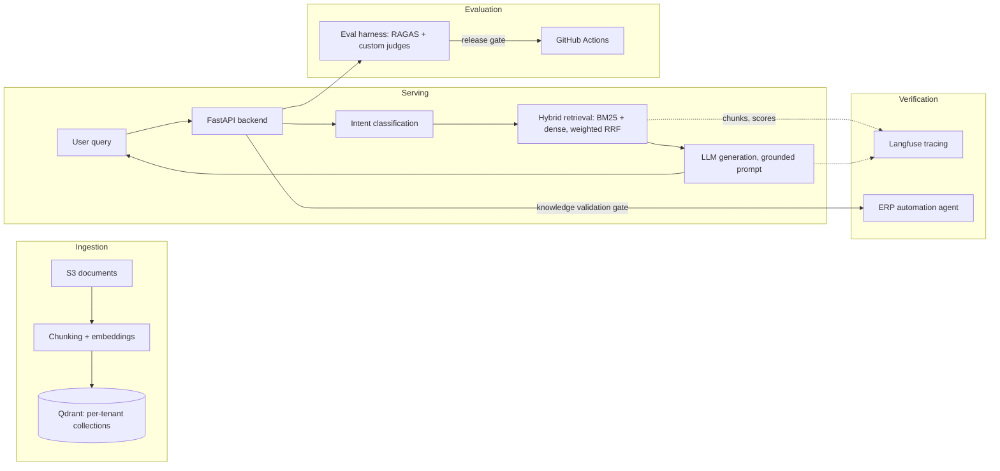

# Alex: Production RAG Assistant

Multi-tenant retrieval-augmented assistant in production since 2023, serving 200+ enterprise users across two SaaS verticals (ERP and FP&A). Peak load ~500 queries/day at sub-3-second median latency over 50K+ vector chunks.

The system is built as one pipeline: ingestion, retrieval, generation, evaluation, observability. Every release is gated on eval scores. No component ships unverified.

## Production metrics

| Metric | Value |
|---|---|
| Active users | 200+ across 2 tenants |
| Peak query volume | ~500/day |
| Median query latency | sub-3s end to end |
| Index size | 50K+ chunks (Qdrant) |
| First-contact resolution | ~60% of consultant queries |
| Golden evaluation dataset | 500+ questions |
| Answer accuracy (release-gate metric) | 9.1/10 average (RAGAS-scored, human-validated) |

## Architecture



Alex also serves as a knowledge validation gate for the companion ERP automation agent: before any write executes against the ERP API, the agent must ground its intent in retrieved, verified documentation.

## Retrieval pipeline

- Hybrid retrieval: BM25 plus dense vectors, fused with weighted reciprocal rank fusion on Qdrant
- Incremental document ingestion from S3
- Per-tenant vector collection isolation
- Redis response caching with explicit invalidation endpoints
- Prompt-managed system instructions (versioned, traced per request)

## Evaluation suite

Evaluation is infrastructure here, not a pre-launch checklist. This is the part of the repo worth reading.

**Headline score:** 9.1/10 average answer accuracy across the 500+ question golden dataset, RAGAS-scored and human-validated. This is the metric releases gate on.

**RAGAS component diagnostics** (0–1 scale, scored against reference answers). These are tracked for regression and to direct investigation; they are not the release score:

| Metric | Score |
|---|---|
| Answer relevancy | 0.80 |
| Context precision | 0.78 |
| Faithfulness | 0.67 |
| Context recall | 0.63 |

These numbers are not presented as a verdict. Manual review of low-scoring cases showed several were phrasing variance against reference answers rather than genuine retrieval or grounding failures. Aggregate scores tell you where to look; only reading the cases tells you whether the problem is real. The review protocol is part of the suite, not an afterthought.

**Custom LLM-as-judge evaluators** for machine-consumable output (when the reader is another model, not a person), 49-question set across three question categories:

| Category | n | Extractability | Refusal clarity |
|---|---|---|---|
| Clear factual | 23 | 0.94 | 1.00 |
| Out-of-scope | 12 | 0.92 | 1.00 |
| Ambiguous, broad | 14 | 0.54 | 0.93 |

Reading: specific questions produce cleanly extractable answers; broad questions do not, regardless of retrieval quality. That is a question-shape problem for the calling layer, not a retrieval defect.

**Release gate:** every deploy gates in GitHub Actions via Langfuse on the golden dataset holding ≥9.0/10 average accuracy, with component diagnostics and custom-judge scores checked for regression.

## Observability

- Full Langfuse tracing: query, retrieved chunks with content, ranking, generation, per-request scores
- Chunk-level retrieval visibility: every answer can be traced to exactly which chunks it consumed
- LangSmith experiments versioned against the fixed dataset, comparable run over run at question level

## Operational notes: two real bugs the eval harness caught

1. **Trace-matching race condition.** Early eval runs matched outputs to the "latest" Langfuse trace. At scale this silently mismatched ~32% of rows. Fixed with content-verified matching, bounded retries, and time windows.
2. **Response-cache staleness.** A 24h cache caused re-tests of the same question to return stored answers with no new tracing, polluting evaluation. Detected by harness anomalies; resolved via explicit cache-clear before test runs.

Both bugs were invisible at small scale. They were found because evaluation runs at production scale, not on samples.

## Stack

Python, FastAPI, LangChain, Qdrant, Postgres, Redis, S3, Anthropic Claude, Langfuse, RAGAS, LangSmith, Docker, Kubernetes.

## Repository layout

```
ingestion.py        S3 sync, chunking, embedding jobs
retrieval.py        hybrid search, weighted RRF fusion, Qdrant client
generation.py       grounded prompts, explicit refusal protocol
main.py             FastAPI serving layer, caching, cache-clear endpoint
run_ragas.py        golden dataset harness, RAGAS baseline runner
custom_judges.py    extractability and refusal clarity LLM-as-judge evaluators
config.py           retrieval weights, endpoints, model names
tests/              unit tests for RRF fusion and refusal detection
data/docs/          synthetic ERP and FP&A source documents
```

## Roadmap

- Agent trajectory evaluation: custom judges for action correctness, authorisation, reversibility over labelled production sessions
- Fine-tuned intent classifier (LoRA), measured against the prompt-based baseline with the same harness
- BigQuery grounding: governed, cost-bounded SQL tool generation for analytical queries

## Note

No tenant data appears in this repository. Examples are synthetic throughout.
